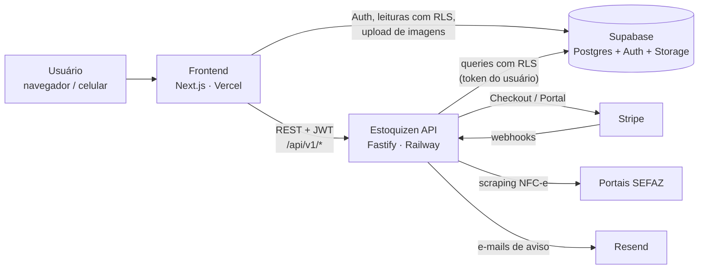

# Estoquizen API

API REST do **Estoquizen**, um SaaS de gestão de estoque para pequenos negócios. Cada empresa tem o seu espaço (workspace) com equipe, papéis de acesso e assinatura própria. Produtos entram manualmente, por leitor de código de barras ou importando a NFC-e (cupom fiscal) direto da SEFAZ.

🔗 **Aplicação:** https://estoquizen.vercel.app  
🖥️ **Frontend:** [VictorGoms/Estoquizen](https://github.com/VictorGoms/Estoquizen)

---

## Destaques técnicos

- **Multi-tenant com Row Level Security.** O isolamento entre empresas é garantido no Postgres por policies de RLS, não só no código. Rotas comuns usam um client Supabase autenticado com o JWT do usuário (`supabaseForUser(token)`), então o banco aplica as policies. O client com service role só é usado em operações privilegiadas e explícitas.
- **Autenticação JWT e papéis.** O token do Supabase Auth é validado em um plugin Fastify (`fastify.authenticate`). Cada membro tem um papel (`owner`, `admin` ou `member`). Os convites seguem fluxos diferentes para usuário novo, usuário ainda não confirmado e usuário que já tem conta.
- **Billing com Stripe.** Checkout Session, Customer Portal e webhook com validação de assinatura sobre o *raw body*, que recusa tudo se o segredo não estiver configurado e não processa o mesmo evento duas vezes. Eventos tratados: `checkout.session.completed`, `invoice.paid`, `invoice.payment_failed`, `customer.subscription.updated` e `customer.subscription.deleted`. A assinatura só é ativada pelo webhook, nunca pela URL de retorno do checkout.
- **Trial e ciclo de vida da assinatura.** O plano Growth tem trial limitado a 1 por CPF. Um job com `node-cron` roda todo dia às 4h UTC: expira trials, envia e-mail de aviso (via Resend) após 14 dias sem pagamento e remove o workspace após 30. Workspaces expirados ficam em modo somente leitura (403 nas rotas de escrita).
- **Importação de NFC-e.** Recebe a chave de 44 dígitos, identifica o estado pelo código da UF e faz *scraping* do portal público da SEFAZ com `cheerio`. Os itens são normalizados (unidade, preço unitário, EAN) e o resultado fica em cache por 24h, já que a nota é imutável. O foco é SP; URLs de outros 9 estados estão mapeadas.
- **Ajuste de estoque atômico.** Entradas e saídas passam pela função Postgres `adjust_product_qty`, que atualiza a quantidade e grava o histórico em `movements` na mesma transação. Isso evita condição de corrida com vários usuários ao mesmo tempo e impede estoque negativo. As quantidades são decimais, para kg e litros.
- **Limites por plano no servidor.** Número de produtos, membros e convites por dia são validados na API a partir de uma única fonte de verdade (`src/lib/plans.ts`).
- **Validação e segurança.** Todo body é validado com **Zod** antes de chegar no banco, com sanitização por tipo (texto, código, e-mail, CPF). Erros do banco passam por `dbError()` para não expor nomes de tabelas ou constraints. A API usa `@fastify/helmet`, CORS restrito por variável de ambiente e rate limit por usuário (com fallback para IP). Ver [Segurança](#segurança).
- **Documentação.** Swagger UI em `/docs`, só em desenvolvimento: em produção a rota não existe.
- **Respostas padronizadas.** As rotas de `/api/v1` respondem no formato `{ data, error }`.

## Segurança

### Controles

- **Isolamento entre empresas no banco.** RLS em todas as tabelas e GRANT por coluna: o cliente nunca lê o CPF de ninguém nem grava plano, estoque ou membros direto no Supabase. Tabelas internas (assinaturas, eventos do Stripe, registros de trial) não têm acesso nenhum pela chave pública, e o visitante sem login não lê tabela nenhuma.
- **Service role com checagem explícita.** Toda rota que usa o client com service role confere antes se a pessoa é membro ativo do workspace e se o papel basta (`requireMember`).
- **Webhook do Stripe.** Assinatura conferida sobre o *raw body*; sem o segredo configurado, responde 503 em vez de aceitar. Cada evento é processado uma vez (`stripe_events`), e a assinatura é relida no Stripe, porque os eventos podem chegar fora de ordem.
- **Convites.** O aceite usa o workspace que vem no link do e-mail, só a própria pessoa convidada pode aceitar, e revogar um convite não apaga a conta de ninguém. O perfil de quem ainda não aceitou não aparece para a empresa que convidou.
- **Cobrança.** A troca de plano só acontece pelo fluxo que confere se o uso cabe no plano novo. A desistência em 7 dias grava uma reserva com índice único antes do estorno, contra pedidos simultâneos. Os ids do cliente e da assinatura no Stripe só aparecem para o dono do workspace.
- **Estoque sem lançamento duplicado.** Entrada e saída aceitam `Idempotency-Key`: a mesma chave do mesmo usuário em até 2 minutos devolve a primeira resposta sem gravar de novo (dois toques no botão, reenvio depois de queda de rede).
- **Fotos.** Os buckets do Storage aceitam só JPG, PNG e WebP de até 5 MB, e cada empresa só grava na própria pasta.
- **Contas.** Cadastro e troca de senha recusam senha que já apareceu em vazamentos (HaveIBeenPwned por k-anonimato, no front). O CAPTCHA da Cloudflare (Turnstile) está pronto no login, no cadastro e na recuperação de senha, e liga por variável de ambiente.
- **Entrada de dados.** Zod em todo corpo de requisição; o tamanho das listas é conferido antes da validação, contra estouro de memória; texto que vai para e-mail não aceita `<` nem `>`, e os e-mails escapam o HTML.
- **Dados compartilhados.** O catálogo de nomes por código de barras só aceita nome lido de um portal oficial da SEFAZ ou digitado igual por empresas de donos diferentes.
- **Limites.** Rate limit por usuário (JWT com assinatura verificada) ou por IP; rotas `/admin` com segredo comparado em tempo constante e limite próprio.
- **Superfície exposta.** Em produção não há Swagger nem `/docs`; a especificação só existe rodando local.

### Verificações feitas

| Data | O quê | Resultado |
|---|---|---|
| 2026-10-17 | Varredura de segredos (gitleaks, trufflehog e padrões da stack) no histórico inteiro dos dois repositórios e no bundle de produção | Nada vazou; no navegador só chaves públicas |
| 2026-10-19 | Auditoria de dependências (`npm audit`) e teste do rate limit em produção | Next 16.4 e Fastify 5, sem avisos em produção; token forjado deixou de ganhar limite próprio |
| 2026-10-23 | Auditoria completa com a metodologia de auditoria de segurança da Cloudflare e as boas práticas do Stripe: fronteiras de confiança, só achados com evidência, prioridade por gravidade | 8 achados (1 alto, 4 médios, 3 baixos), todos corrigidos e publicados em 2026-10-24 |
| 2026-10-24 | Segunda rodada sobre o código corrigido e nova varredura de segredos (todas as branches e os commits ainda não publicados) | 2 achados (1 médio, 1 baixo), corrigidos antes de irem ao ar; nenhum segredo |
| 2026-10-28 | Revisão de uma lista de 19 pontos de segurança (API, banco, Storage e painel do Supabase) | 4 ajustes, todos feitos: limite de tipo e tamanho das fotos, ids do Stripe só para o dono, `/docs` fora de produção com idempotência na entrada e saída, senha vazada e CAPTCHA |

### Como é testado

- **Regressão:** cada correção tem um teste que falha no código antigo. As rotas são testadas com um Supabase simulado (`test/apoio/supabaseFalso.ts`), sem banco e sem rede; Stripe e Resend também são simulados. `npm test`.
- **Banco:** `supabase/tests/conferir_seguranca.sql` confere, só lendo, RLS, GRANTs, funções `SECURITY DEFINER`, o Storage e a visibilidade de convites pendentes. Antes das correções acusava 25 problemas; hoje dá OK.
- **CI:** tipos e testes a cada push no GitHub Actions.

## Arquitetura



## Stack

| Camada | Tecnologia |
|---|---|
| Runtime | Node.js + TypeScript (ESM) |
| Framework | Fastify 5 |
| Banco / Auth | Supabase (Postgres, RLS, funções PL/pgSQL), sem ORM |
| Validação | Zod |
| Pagamentos | Stripe (Checkout, Billing Portal, Webhooks) |
| Jobs | node-cron |
| E-mail | Resend |
| Scraping | cheerio |
| Segurança | @fastify/helmet, @fastify/cors, @fastify/rate-limit |
| Docs | @fastify/swagger + Swagger UI |

## Rotas

Todas ficam sob `/api/v1` e exigem `Authorization: Bearer <access_token>`, exceto as indicadas.

| Método | Rota | Descrição |
|---|---|---|
| GET | `/health` | Health check (pública) |
| GET | `/products?workspace_id=` | Lista produtos do workspace |
| GET | `/products/:id` | Detalhe do produto |
| POST | `/products` | Cria produto (valida limite do plano) |
| PATCH | `/products/:id` | Atualiza produto |
| DELETE | `/products/:id` | Remove produto (owner/admin, via RLS) |
| POST | `/products/:id/adjust` | Entrada/saída de estoque (atômico) |
| GET | `/products/:id/movements` | Histórico de movimentações |
| GET | `/workspaces` | Workspaces do usuário |
| GET | `/workspaces/:id/stats` | Contadores do dashboard |
| POST | `/workspaces` | Cria workspace, owner e assinatura |
| PATCH | `/workspaces/:id` | Atualiza workspace |
| DELETE | `/workspaces/:id` | Exclui workspace (só owner; cancela no Stripe) |
| GET | `/members?workspace_id=` | Lista membros com perfil |
| POST | `/members/invite` | Convida membro (limite do plano e diário) |
| POST | `/members/accept` | Aceita convite pendente |
| PATCH | `/members/:id` | Atualiza papel/status/perfil |
| DELETE | `/members/:id/invite` | Revoga convite pendente |
| DELETE | `/members/:id` | Remove membro |
| POST | `/nfe/consultar` | Consulta NFC-e pela chave de 44 dígitos |
| GET | `/billing/subscription?workspace_id=` | Estado da assinatura (ids do Stripe só para o dono) |
| POST | `/billing/checkout` | Cria Stripe Checkout Session |
| POST | `/billing/portal` | Cria sessão do Customer Portal |
| POST | `/webhooks/stripe` | Webhook do Stripe (fora de `/api/v1`, sem JWT, valida assinatura) |
| POST | `/admin/cleanup` | Executa o job de limpeza manualmente (fora de `/api/v1`, protegido por `CRON_SECRET`) |

A especificação completa fica em `http://localhost:3001/docs` com a API rodando em desenvolvimento.

## Estrutura

```
src/
  server.ts            bootstrap: plugins, rate limit, swagger, cron
  plugins/auth.ts      validação do JWT → req.user
  routes/v1/           products, workspaces, members, nfe, billing
  routes/webhooks.ts   webhook do Stripe
  routes/admin/        disparo manual do cleanup
  schemas/             schemas Zod
  lib/                 supabase, planos, NFC-e, Stripe, cleanup, sanitização, respostas
test/                  testes (Vitest): regras puras e rotas com Supabase simulado
supabase/
  migrations/          migrações SQL (fonte da verdade do banco)
  tests/               conferir_seguranca.sql (conferência só de leitura)
database/
  schema.sql           tabelas, RLS e funções
  seed.sql             dados de exemplo
```

## Como rodar localmente

**Pré-requisitos:** Node.js 20+, um projeto no [Supabase](https://supabase.com) e, para billing, uma conta Stripe em modo teste.

```bash
git clone https://github.com/VictorGoms/Estoquizen-API.git
cd Estoquizen-API
npm install
cp .env.example .env    # preencha com as suas chaves
```

1. **Banco.** No Supabase, abra o SQL Editor e rode `database/schema.sql` (opcionalmente, `database/seed.sql` depois).
   > ⚠️ O `schema.sql` ainda não inclui a parte de billing: tabela `subscriptions`, coluna `profiles.cpf`, plano `growth` no check de `workspaces.plan`. Consolidar isso em migrações versionadas está em [Próximos passos](#próximos-passos).
2. **Variáveis.** O `.env.example` lista e explica cada variável: Supabase, CORS, Stripe, Resend, `CRON_SECRET`.
3. **Subir a API:**
   ```bash
   npm run dev      # http://localhost:3001  ·  docs em /docs
   ```
4. **Webhooks do Stripe (opcional):**
   ```bash
   stripe listen --forward-to localhost:3001/webhooks/stripe
   ```

Outros scripts: `npm run build` (compila para `dist/`), `npm start` (roda o build) e `npm run lint` (checagem de tipos).

## Próximos passos

O projeto foi construído como produto real. Estes pontos ainda não existem e são os próximos da lista:

- **Testes de RLS na CI.** As mudanças do banco já são migrações versionadas, mas as policies originais foram criadas pelo painel. Falta gerar o baseline do schema para recriar o banco do zero e rodar testes de RLS (pgTAP) a cada push.
- **Docker.** `Dockerfile` e `docker-compose` para subir o ambiente local com um comando.
- **Observabilidade.** Logs estruturados e alertas para falhas do webhook e do job de limpeza.
- **Atualizações com mudança de versão.** Zod 4 e a versão nova da API do Stripe.
- **CSP valendo no front.** Hoje a política é publicada em modo de relatório; falta passar a bloquear.
- **CAPTCHA ligado.** O componente já está no front; falta criar o widget na Cloudflare e ativar no Supabase Auth.
- **Supabase Pro com o primeiro cliente pagante.** Traz o bloqueio nativo de senha vazada (substitui a checagem do front) e backup diário com 7 dias de histórico.

## Autor

**João Victor** · [GitHub](https://github.com/VictorGoms) · [LinkedIn](https://www.linkedin.com/in/jo%C3%A3o-victor-da-silva-gomes-a47315237)
